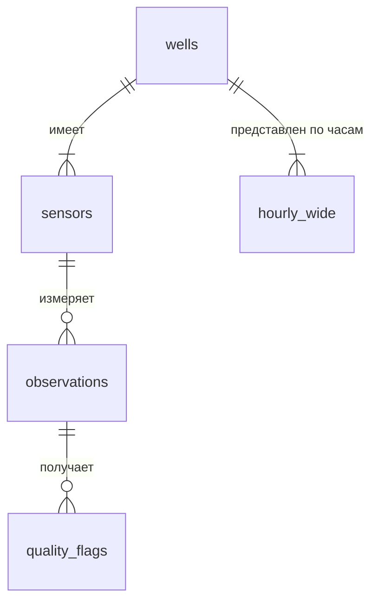

# Аудит качества данных датчиков нефтяных скважин NK

**Yerengaiyp Rakymzhan · ADA-2603**  
Cluster 5 · Sensor Data Quality Audit and ETL Pipeline

Проект проверяет, какие часовые измерения доступны по каждой скважине, где возникают пропуски и как флаги и изменения режима влияют на интерпретацию рядов. Итоги можно проверить по SQL-запросам, CSV-таблицам и в интерактивном дашборде.

## Запуск

Распакуйте архив, откройте терминал в папке `nk_project` и используйте Python 3.12. В Windows команды выполняются в PowerShell. Активация окружения не нужна.

```powershell
python -m venv .venv
.\.venv\Scripts\python.exe -m pip install -r requirements.txt
.\.venv\Scripts\python.exe -m streamlit run app.py
```

Откройте адрес из терминала (обычно `http://localhost:8501`). Дашборд использует готовую базу и сводки в `results/`. В macOS/Linux в этих командах путь к Python окружения будет `.venv/bin/python`.

Чтобы пересчитать проект с исходных файлов, выполните:

```powershell
.\.venv\Scripts\python.exe run.py
```

При первом пересчёте скрипт получает три CSV с Hugging Face. При ручной загрузке положите файлы в `data/` под именами `train.csv`, `test.csv`, `v1.csv`. Скачивание привязано к ревизиям, а SHA-256 проверяется при каждом прогоне. Пересчёт обновляет SQLite, таблицы и четыре PNG в `results/`.

| Локальное имя | Источник |
| --- | --- |
| `train.csv` | [NK v2 — train.csv](https://huggingface.co/datasets/Arailym-tleubayeva/NK-Oil-Well-Sensor-Monitoring-v2/resolve/4004bb78ca8811a87c2892a89e457c59d22ace2b/train.csv) |
| `test.csv` | [NK v2 — test.csv](https://huggingface.co/datasets/Arailym-tleubayeva/NK-Oil-Well-Sensor-Monitoring-v2/resolve/4004bb78ca8811a87c2892a89e457c59d22ace2b/test.csv) |
| `v1.csv` | [NK v1 — wells_dataset.csv](https://huggingface.co/datasets/Arailym-tleubayeva/NK-Oil-Well-Sensor-Monitoring/resolve/84e5103cef58c85dc924e4b47aaed8ef2c5cb3dd/wells_dataset.csv) |

## Как устроен проект

| Файл | Что в нём |
| --- | --- |
| `run.py` | Последовательно запускает загрузку, pivot, SQL-аудит, сравнение, EDA и построение рисунков |
| `etl.py` | Читает и проверяет CSV, формирует wide и загружает таблицы в SQLite |
| `schema.sql`, `queries.sql` | Схема базы и 10 запросов с именами, совпадающими с именами выгрузок |
| `analysis.py` | Сравнивает интервалы между методами и значения между версиями, рассчитывает статистику |
| `visuals.py`, `app.py` | Четыре рисунка Matplotlib и интерактивный график Plotly в Streamlit |



`wells` хранит тип скважины. `sensors` хранит доступные пары «скважина–параметр» и единицы измерения. Ключ `observations` состоит из `well_id`, `parameter` и `timestamp`. В `quality_flags` комбинированный `flag` разбит на отдельные признаки. В производной `hourly_wide` ключ состоит из `well_id` и `timestamp`, а каждый параметр занимает отдельную колонку.

### Поиск пропусков

В long одна строка соответствует измерению одного параметра в один час. Pivot даёт 65 520 строк wide, по одной строке на каждый час каждой скважины. Часы без измерений остаются пустыми. Для подсчёта пропусков учитываются только 43 существующие пары «скважина–параметр». Например, `casing_pressure` у NK-76 отсутствует в схеме датчиков. Нулевое измерение остаётся числовым значением.

`LAG` получает предыдущую метку внутри каждой пары. Если соседние записи разделяют три часа, между ними два пропуска. По обеим границам периода добавляются вспомогательные метки, чтобы этот же расчёт находил отсутствие значений в начале и конце окна.

Сравниваются календарная сетка (baseline), разница соседних часов в Pandas и `LAG` в SQLite. Методы запускаются отдельно на официальных train и test. Precision и recall проверяют полное совпадение начала, конца и длины интервала с календарной сеткой. Время — медиана семи запусков после подготовки входов. Для SQL замер включает выполнение запроса и чтение результата в DataFrame.

### Как читать результаты

- `coverage.csv` показывает пропуски и знаменатель для каждой пары. `gaps.csv` хранит интервалы по всему периоду, `common_outages.csv` — часы без измерений по всем скважинам.
- `flag_combinations.csv` считает строки с исходным `flag`, `flag_tokens.csv` — отдельные признаки. Одна строка с двумя признаками входит в оба счётчика признаков. Флаги описывают подозрительные исходные записи внутри часа.
- `area_may_shift.csv` сравнивает медиану мая с медианой января–апреля. `nk7_regime.csv` сравнивает январь–май и июнь–сентябрь.
- `version_comparison.csv` показывает совпадение ключей, метаданных и значений в общем периоде v1/v2. MAE считается отдельно по параметрам в их единицах. Допуск 0,00005001 соответствует округлению до четырёх знаков после запятой с запасом на представление числа.
- `eda_descriptive.csv` содержит описательную статистику по типу и параметру. `eda_diurnal.csv` и `corr_*.csv` используют отклонения от медианы своей скважины, параметра и месяца. `corr_n_*.csv` показывает число пар, на которых рассчитана каждая корреляция.

В описательной статистике, суточном профиле и корреляциях используются числовые часы без `flag`. Из расчёта корреляций для `dynamometer_area` дополнительно исключены май у всех насосных скважин и июнь–сентябрь у NK-7. Сырые значения и флаги доступны в базе.

## Как показать проект на защите

1. Откройте дашборд и оставьте NK-7, `SPM`, январь–сентябрь. Покажите снижение уровня ряда с июня. Вертикальный пунктир на графике отмечает границу train/test в августе.
2. Выберите NK-75 → `line_pressure` → июнь–сентябрь, чтобы показать длительный разрыв. Объясните расчёт на примере двух соседних меток в SQL.
3. Откройте сравнение методов. Покажите, что все три метода нашли одинаковые интервалы на test. Объясните, почему время зависит от размера окна, хранения и реализации.
4. Откройте сверку v1/v2. Покажите, что совпадающие ключи могут иметь разные измерения. Для отчётов используйте значения одной версии.

Карточки источников: [NK Oil Well Sensor Monitoring v2](https://huggingface.co/datasets/Arailym-tleubayeva/NK-Oil-Well-Sensor-Monitoring-v2), [NK Oil Well Sensor Monitoring v1](https://huggingface.co/datasets/Arailym-tleubayeva/NK-Oil-Well-Sensor-Monitoring). Автор набора — Arailym Tleubayeva. Промышленные данные предоставлены ТОО «Галаз и Компания». Лицензия релизов — Apache 2.0.
